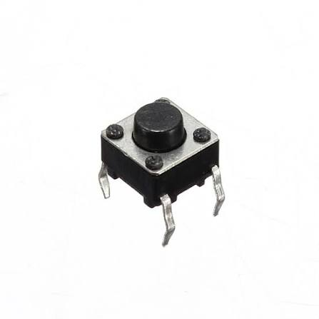

# Componentes

- Motor reductor de plástico 4

  

- Módulo motor 

   

- Sensor-ultrasinco 2
  

- Sensor IR 2

  

  -Push button 

  

  # Electronica
### Pin-Out (fase 1)
)

*Este circuito tiene dos pulsadores reemplazando los dos IR que vamos a usar, los leds sirven de referencia para el modulo L298N, ademas los motores usaran los pines pwm para poder aplicar el porcentaje de velocidad para la embestida.*
