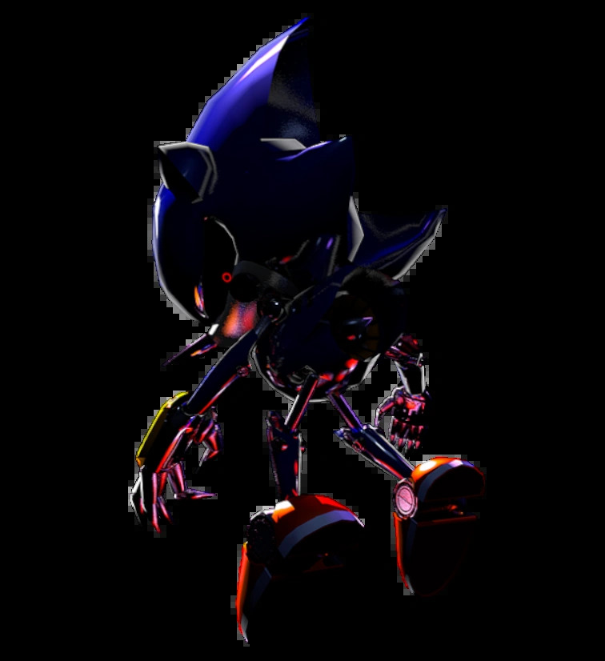

# Robot_Sumo_Syntax Error 

It's a proyect about our Sumo, we save information about it!!!
## Rules 
- **1. Maximum initial size** 
20 × 20 cm; no height limit.
- **2. Maximum weight**
1 kg, including battery and all parts.
- **3. Start** 
Physical button and 3 seconds of inactivity.
- **4. Operation** 
Autonomous, without human intervention or external communication during the round.
-   **5. Sensors and manufacturing** 
Free; cameras, any sensor, 3D printing, CNC, PCB, and other techniques are permitted.
  -  **6. Budget** 
No limit; costs must be documented.
- **Own development.**
- **Inspection and changes.**

### Combat Rules 

## Inspirations

Well, we're gonna add something like a charge, I took the inspiration from Metal Sonic's "Outcome Memories".

He has the ability "Destructive Charge", we're adding this to the Sumo in some way.

## 

